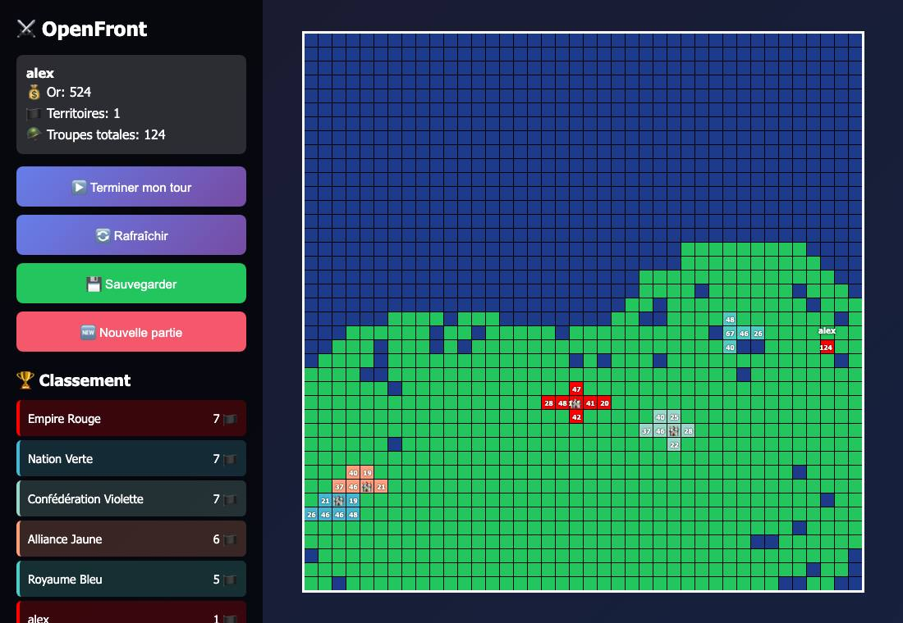
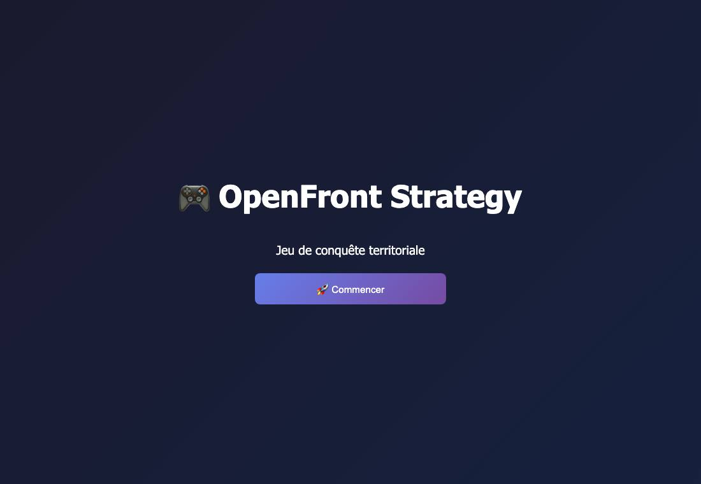

# Call of War 2.0

> C'est l'un de mes premiers jeux : un jeu de stratégie et de conquête au tour par tour, inspiré d'[OpenFront](https://openfront.io), que j'ai refait en Python.

▶ **Jouer en ligne :** https://call-of-war-2-3.onrender.com (hébergé gratuitement sur Render : le premier chargement peut prendre une minute)



## Le jeu

Une carte de 40 × 40 cases, avec des continents tirés au hasard à chaque partie. Tu commences avec une seule case et 100 soldats, face à 5 empires contrôlés par l'ordinateur.

- **Clique sur une case voisine** pour l'attaquer et choisis combien de soldats envoyer. Le défenseur a un bonus (×1,3 à ×1,6), donc il faut venir en nombre.
- **Construis des villes** (300 or) : elles donnent +10 soldats par tour.
- **À chaque fin de tour**, chaque territoire rapporte 2 or et 2 soldats. Les bots attaquent, construisent et s'étendent tout seuls.
- **Le classement et l'historique** montrent qui domine la carte.
- **Comptes joueurs et sauvegardes** : il y a des boutons *Sauvegarder* et *Nouvelle partie*.

| Accueil | Partie |
|---|---|
|  |  |

## Lancer le jeu

```bash
pip install -r requirements.txt
python app.py
```

Ouvre ensuite http://localhost:5000, crée un compte et lance une partie.

## Technique

- **Langage et serveur :** Python avec Flask. Tout le jeu tient dans `app.py` : la carte, l'IA des bots et les pages HTML.
- **Affichage :** la carte est une grille HTML. Les actions (sélection, attaque, ville, tour suivant) passent par une petite API JSON (`/api/...`).
- **Mise en ligne :** le `Procfile` (`gunicorn app:app`) permet de l'héberger sur Render ou Heroku. Pense à définir la variable `SECRET_KEY`.
